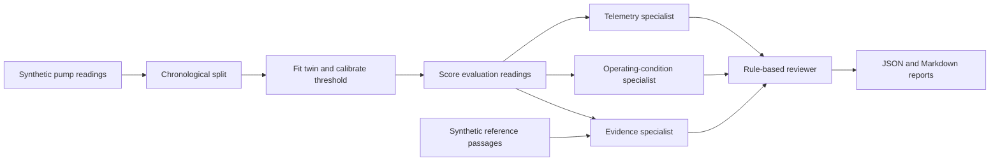

# How the current system works

This document describes implemented behavior. Proposed work belongs in the
[roadmap](roadmap.md); verification results belong in [status](status.md).

## One package, one local pipeline



The default engine calls ordinary Python functions in sequence. The optional
LangGraph engine runs the three specialists in parallel and waits for all three
before review. They share the same functions; using LangGraph does not add an LLM.

CSV and Snowflake readers are available as Python interfaces, but are not yet
connected to the demo CLI. The demo always generates its own data. MCP exposes
retrieval and an in-memory demo investigation; it is not a general gateway to
other MCP servers.

## Where to change behavior

All paths below are relative to `src/factory_investigator/`.

| Module | Responsibility |
| --- | --- |
| `data.py` | Reading validation, CSV I/O, Snowflake read adapter |
| `simulation.py` | Seeded pump readings and injected bearing symptoms |
| `twin.py` | Linear fitting, residual calibration, scoring |
| `retrieval.py` | Synthetic passages and lexical retrieval with citations |
| `investigation.py` | Specialist functions, reviewer, optional LangGraph wiring |
| `demo.py` | Experiment splits, evaluation metrics, output files |
| `cli.py` | Demo command and arguments |
| `gateway.py` | Two optional stdio MCP tools |

NumPy is the only required runtime dependency. LangGraph, MCP, and Snowflake are
optional extras. There is no application server, database, job queue, or deployment
system to operate.

## Data contract

Each reading belongs to one asset at one timezone-aware timestamp. Timestamps are
normalized to UTC. A training, calibration, or evaluation series must be strictly
chronological, without duplicate timestamps, and contain exactly one asset.

| Field | Meaning / units |
| --- | --- |
| `timestamp` | Timezone-aware observation time |
| `asset_id` | Nonempty asset identifier |
| `speed` | Nonnegative rpm |
| `load` | Normalized value in [0, 1] |
| `ambient`, `temperature` | Degrees Celsius |
| `vibration` | mm/s RMS |
| `pressure` | bar |
| `fault` | Synthetic evaluation label; not a model feature |

Numeric sensor values must be finite. The code does not enforce every physical
range or infer units. Missing data is rejected, not imputed. Readers use half-open
`[start, end)` windows; CSV reads sort selected readings before validation.

Training and calibration data must be curated as healthy by the caller. A default
`fault='healthy'` field does not certify health, and fitting ignores that field.
The Snowflake adapter binds asset/time values and validates the table identifier;
the caller supplies and closes its connection. See the README for its schema.

## What the twin learns

For each of temperature, vibration, and pressure, least squares fits:

```text
expected = intercept + a * (speed / 1800) + b * load + c * (ambient / 30)
```

Training requires at least 30 readings and a full-rank feature matrix. Calibration
requires at least 30 subsequent readings from the same asset. Evaluation must
start after calibration, preventing accidental reuse of fitted/calibrated periods.

Training residual standard deviations, floored at `1e-6`, normalize each sensor's
error. The reading score is the largest absolute normalized error among the three
sensors. The alert threshold is the greater of 3 and the calibration scores' 99th
percentile, using NumPy's `higher` quantile method. A score strictly above the
threshold is anomalous. This threshold is empirical, not a probability guarantee.

Operating conditions outside training min/max ranges produce a separate warning.
They are still scored. The current system reports anomalous readings, not grouped
incidents, and does not learn temporal dynamics or degradation trajectories.

## How investigation reaches a conclusion

- The telemetry specialist counts anomalies and records the first flagged time.
  It calls a sensor elevated when its signed normalized error exceeds 3 in at
  least half of anomalous readings.
- The operating specialist counts readings outside the training envelope.
- The evidence specialist queries four built-in synthetic passages using deviating
  sensor names plus the fixed terms `bearing maintenance`. Retrieval uses a
  BM25-style lexical score and returns source, section, text, and citation.
- The reviewer selects a predefined hypothesis from the telemetry summary. Elevated
  temperature and vibration lead to a bearing/lubrication hypothesis; other
  deviations receive a generic investigation recommendation.

Retrieved passages accompany the hypothesis; the reviewer does not infer the
hypothesis from their text or verify each claim against a citation. The query is
biased toward the demo's bearing scenario. This is an inspectable retrieval and
rule baseline, not general RAG reasoning or autonomous diagnosis. Evidence has no
asset/time access filtering yet, and suggestions never execute equipment actions.

## Outputs and reproducibility

`factory-investigator demo --seed 42 --output artifacts/demo` writes:

| File | Contents |
| --- | --- |
| `telemetry.csv` | All 720 generated readings, including evaluation labels |
| `scores.json` | 216 evaluation readings with expected/observed values and scores |
| `report.json` | Findings, evidence, operating warnings, limitations, experiment metrics |
| `report.md` | Human-readable hypothesis, counts, metrics, evidence, checks, limitations |

JSON is the fuller record: Markdown currently omits some fields such as the
operating-envelope summary. Output names are overwritten on repeat runs. Models
and graph state are kept in memory, not persisted. Seeds reproduce synthetic
inputs; dependency versions are ranged rather than locked, so exact cross-version
floating-point results are not promised.

## Keep changes small

Use a function or an existing module before creating another abstraction. Extract
an interface when a second real implementation needs it, not for hypothetical
future providers. Keep the CLI demo usable with the core dependency alone.

For each feature, state the user-visible behavior and a meaningful acceptance
check. Add dependencies only when the current implementation cannot reasonably
satisfy that behavior. Optional integrations should remain at the package edges.
